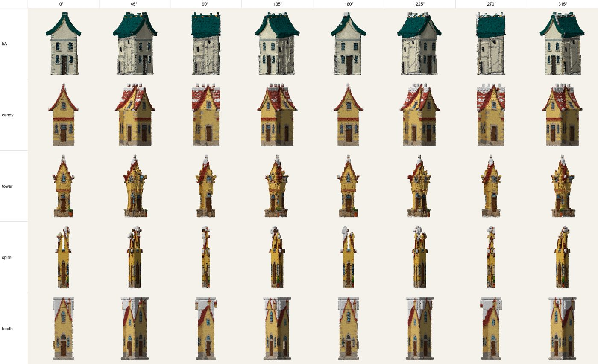
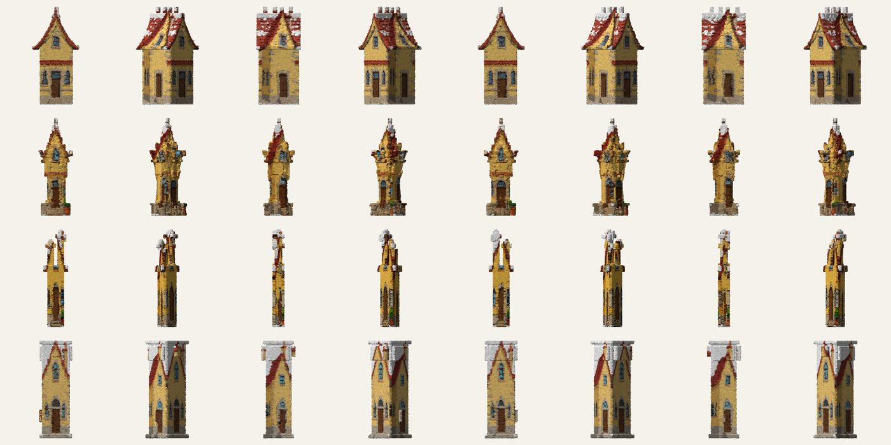
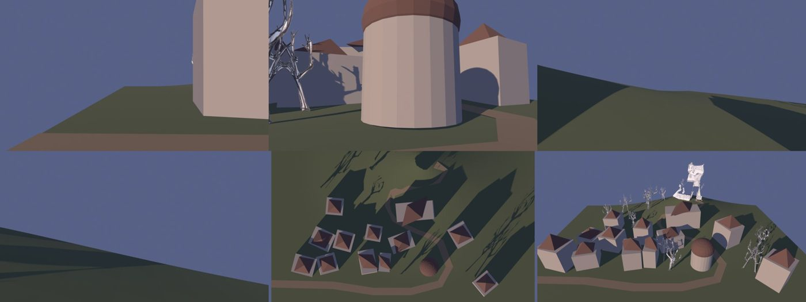
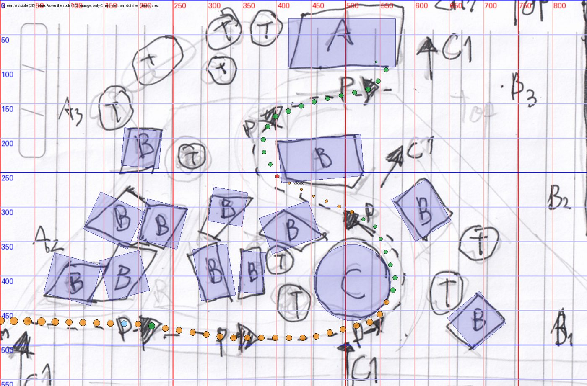

# Drawing pipeline skills

These are Claude Code skills, plus the scripts they call, for turning hand-drawn pencil pages into 3D.

Each folder has a `SKILL.md`. Copy the folder into `~/.claude/skills/` and Claude Code will use it when you ask, for example "splat my drawing" or "make my level map 3D". You can also just read the steps and run the scripts yourself.

| Skill | What it does |
|---|---|
| [dreamsplat](dreamsplat/SKILL.md) | Drawing -> 3D shape -> painted front/side views -> a Dreams-style model made of brush strokes -> a **reference sheet** (one row per object, one column per angle) that you paint over and feed back in to recolour the strokes. |
| [drawing-to-building](drawing-to-building/SKILL.md) | Front, side and angled drawings of a building -> flat-colour views -> Hunyuan3D parts -> sizes measured from a depth pass on the angled sketch -> assembled model with the drawings projected back on as its texture. |
| [drawing-to-level](drawing-to-level/SKILL.md) | A top-down level map drawing -> `layout.json` -> Blender blockout rendered from the cameras you drew -> level analysis: landmark visibility along the path, reveal, squeeze/release (isovists), clearance, winding. |

## What you need
- Windows, an NVIDIA GPU with 12 GB (an RTX 4070 Ti was used), and Python 3.13 for the CPU scripts.
- [Hunyuan3D-2](https://github.com/Tencent/Hunyuan3D-2) in its own venv. Its python is `$HUNYUAN_PY` in the docs.
- FLUX.1 Kontext [dev] through diffusers, also in its own venv. Its python is `$KONTEXT_PY`, and `kontext_edit.py` is a small wrapper: input image, output image, prompt, `--steps`, `--guidance`, `--long`.
- Blender 4.x or 5.x, run headless with `blender -b --factory-startup -P script.py -- args`.
- For the level analysis: `pip install pysovist shapely numpy pillow`.
- Paths in the docs are relative to your work folder, and placeholders like `<Hunyuan3D-2 folder>` stand for your own install.

These are working notes from a real project: dates, results and gotchas are left in on purpose.
